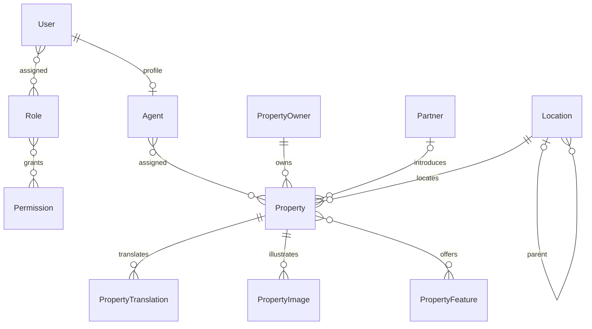

# KANTARA

Single Next.js application for international property services in Cambodia.
The project currently provides the database foundation, a read-only public
REST API, a seven-language visual property preview and a local-only agency
workflow demonstration with connected CRM/calendar and bilingual draft PDFs. It is not a complete
agency management product.

## Visual demonstration

Run `npm run dev` and open `/fr` (or any of the seven locale routes) to view the
Khmer-inspired public preview: light blue, warm yellow and deep blue text,
original local SVG architectural illustrations and responsive property cards.
Shared semantic color tokens cover the public pages, administration, calendar,
logo, favicon and social image while maintaining AA text contrast.
Geometric Khmer-inspired backgrounds and layered gradients add depth without
external assets. CSS `color-mix(in oklab, ...)`, container queries, discrete
dialog transitions and scroll-driven hero parallax are progressive enhancements:
the baseline remains visible and usable without them. Parallax is limited to
hover-capable desktop viewports of at least 900px and disabled when reduced
motion is requested. It animates decorative/image layers, not text or forms,
with no JavaScript scroll listener. Keyboard focus remains visible.

The shared footer on public, administration and information pages links to
five localized routes at `/{locale}/information/{legal,privacy,terms,fees,cambodia}`.
These contain substantive demonstration disclosures, cookie/storage behavior,
mandate/fee guidance and Cambodian agency/property checks, with links to RPR,
MLMUPC, GDT, JICA and a clearly identified constitutional translation.
Language navigation retains the selected information topic.
Information routes provide a lightweight loading shell; unknown topics are
rejected by the proxy before streaming, preserving an actual HTTP 404 response.
They are not certified legal policies or a compliance guarantee.
Before commercial use, supply and verify the actual legal entity, registered
address, registrations/tax identity, applicable licences, publication contact,
hosting details, fee schedule and production privacy/complaints contacts, and
obtain Cambodian legal review. No licence, membership, legal commission rate,
invented contact details or completed Vercel deployment is claimed.
Information pages remain `noindex, nofollow` like the rest of the prototype.

The public catalogue offers grid/list/map views and a favorites selection, also
editable from property dialogs. Favorites can be combined with all search
criteria; resetting the search exits favorites-only mode without clearing the
selection. Favorites and view preferences are page-local: reloading or changing
language resets them. No account or browser-storage persistence is implied.

Six fictional listings are stored in `lib/demo/properties.ts`, with localized
titles and descriptions in the seven message dictionaries. The catalogue
supports sale/rental, destination and property-type filters, inclusive minimum/
maximum price, living area, bedrooms and rooms, ascending/descending numeric
sorting, available/sold/rented filters, oldest/newest publication dates, a reset action,
an empty state and accessible native property-detail dialogs (Escape to close).
Filters are local UI state and reset on reload or language navigation.
Submit Search to apply all criteria together. Mixed price sorting groups sales
before rentals, sorting within each group rather than comparing purchase prices
with monthly rents. Prices are illustrative USD amounts; area means living area,
not land area. The same filter component and logic serve the admin property list.

In development the catalogue reads published listings from the browser's
local demo API workspace (described below); production uses the six fixtures.
Neither mode seeds, reads or modifies PostgreSQL, and neither is a fallback for
`/api/v1/properties`.
The visible banner, listing references and detail notices identify the data as
fictional. Contact requests are supported as described below; no booking or
live commercial offer is implemented.
These illustrations are concepts, not photographs of actual properties.
No external image or font service is required; Khmer and CJK font rendering
uses the platform's installed fallback fonts.

The public preview is currently always visible on localized homepages. Replace
it with the live catalogue before a commercial launch; it is not controlled by
database availability.

### Map, full property pages and contact requests

The map uses Leaflet and OpenStreetMap raster tiles without a paid API key.
Tiles load **only after the visitor activates the map**; before activation no
OpenStreetMap request is made. Attribution stays visible. Browser caching is
respected; there is no offline download or tile prefetch. OSM's public tiles
are best-effort, not an unlimited hosted service: review their
[usage policy](https://operations.osmfoundation.org/policies/tiles/) and select
an appropriate tile provider before high-volume commercial use.

Map markers follow all current catalogue filters and favorites. Nearby markers
are grouped at wide zoom levels; selecting a group zooms in and offers links
to every listing, instead of hiding one property behind another. Each individual marker
is a keyboard-focusable link directly to `/{locale}/properties/{id}`. The six
fixture coordinates are deliberately approximate and fictional. New locally
created properties without coordinates remain in the accessible link list,
not at invented map positions. Tile failures show a message while links remain
usable. Full pages include the localized description, price/status/date,
surface/rooms/bedrooms/bathrooms, location map, due-diligence guidance and a
contact/visit form. Language links retain the property reference.
Anonymous public browsing does not allocate a persistent CRM workspace;
existing browser workspace cookies still select their published catalogue.
Storage corruption remains an explicit error, not a reset to fixture data.

**Real email delivery is implemented but disabled by default.** Configure in
ignored `.env.local` or Vercel environment settings:

- `CONTACT_ENABLED=true`
- `RESEND_API_KEY`: server-only Resend key.
- `CONTACT_FROM_EMAIL`: sender address on your verified Resend domain.
- `CONTACT_AGENCY_EMAIL`: fallback agency recipient.
- `SITE_URL`: exact canonical origin; HTTPS required in production.
- `NEXT_PUBLIC_TURNSTILE_SITE_KEY`, `TURNSTILE_SECRET_KEY`: free Cloudflare
  Turnstile widget restricted to the site's hostname. Use genuine production
  keys, never Cloudflare testing keys, on a public deployment.
- Optional server-only `CONTACT_PROPERTY_RECIPIENTS`: JSON map of property IDs
  to agent email addresses, for hosted routing until database migration.

Missing configuration returns an explicit unavailable state/503; it never
pretends to send an email. No actual provider account, verified sender/domain
or API credentials have been created by this implementation.

In the local authenticated team demo, administrators can set each active
agent's notification email under Hiring and accounts. The property assignment
chooses the agent; their notification address takes precedence over the
environment mapping, then the agency fallback. Public responses expose only
the agent's display name, never their login, email or HR records. Local
inquiries are stored in the separate private team repository and visible under
Contact requests only to the assigned agent and administrator; unassigned
requests stay administrator-only. Historical requests retain their original
assignment. This does not auto-create a booked visit or a commission.

Production does not access the development team repository. Until those
accounts are migrated, recipient routing uses the server-only environment map
and agency fallback. Production uses Resend as its email record, not a local
CRM queue; add durable database inquiry/outbox storage during migration.
Locally created per-browser listings use `/api/demo/inquiries`; the six shared
fixtures use that endpoint locally and `/api/v1/inquiries` in production.
The local endpoint remains closed in production.

Forms require explicit contact-only consent and a server-verified Turnstile
token (matching hostname, action and request reference). Cloudflare is loaded
only after visitor activation. Submissions are same-origin, bounded to 16 KiB,
schema-validated, honeypot-protected and sent as plain text with a validated
Reply-To address. Only trusted server configuration chooses recipients.
Local persistence reserves a pending request before email transmission,
marks provider acceptance afterward and limits repeated requests per email.
Resend idempotency keys protect retries within its 24-hour window; modifying
the form creates a new reference. Pending requests older than that window
require manual review rather than risking duplicate delivery.
Configure platform/WAF rate limits for `/api/v1/inquiries` before public use;
Turnstile alone is not a distributed rate limiter.

An accepted email is **not** confirmed inbox delivery, an agent response or a
booked visit. Dates are preferences in Cambodia time. No confirmation email is
sent to arbitrary visitor addresses. Map/provider disclosures are included in
the seven-language privacy page. Complete retention, controller/contact,
processor agreements and transfer safeguards before real personal-data use.

### Administration preview

Open `/fr/demo/admin` (or replace `fr` with any supported locale). A link in the
public footer also opens this demonstration. It is intentionally **not**
`/admin`: no private administration or authenticated session is exposed.

The demonstration workspace previews 12 areas: dashboard, properties, CRM,
partners, documents, contracts/mandates, finance, appointments, team/permissions,
reports, settings and activity history. Dashboard cards and follow-up items
navigate to their module. The original preview modules support localized search, status
filtering and a detail dialog. Language links retain the administration preview
path. In development the dashboard, contacts, properties, appointments, contracts,
finance and activity navigation now open the working API workspace directly.
Other modules remain clearly labeled previews. Selected tabs/filters reset on reload;
saved business records do not.
The connected local dashboard includes quick-access buttons for contacts,
leads, properties and appointments; revenue cards open the finance workspace.
Calendar cells distinguish days with events, today's date and the selected day.

### Individual agent accounts and hiring demonstration

Open `/{locale}/demo/team`, linked from the public footer and administration.
This is a **separate authenticated local demo**, not retroactive authentication
of the older `/demo/admin` workspace. It uses its own shared agency file, not
the original per-browser CRM cookies. No existing records are silently copied
or assigned to agents; the administrator explicitly assigns fictional catalogue
properties and adds linked fictional prospects, visits and commission forecasts.
Agents can read only their own assignments, calendar and commission records,
and update their own prospect stages. Administrative records and HR files are
never included in agent responses; authorization is enforced in every API.
This delivery does not provide the full earlier CRM editor inside agent accounts.

Setup in the ignored `.env.local`:

- `DEMO_ADMIN_LOGIN`: unique initial administrator identifier, 4–50 lowercase
  letters, numbers, dots, underscores or hyphens.
- `DEMO_ADMIN_PASSWORD`: initial fictional password, 12–128 characters.
- `DEMO_TEAM_DATA_DIR`: defaults to `.kantara-team`, ignored by Git.

The administrator is initialized once, when the separate local repository is
first used. Changing these variables later does not reset its password. Use the
authenticated password-change form. There is no public signup or agent-created
account. The repository has exclusive locks, schema validation, atomic writes,
restrictive filesystem permissions and explicit corruption/capacity errors.
It supports 24 candidate/agent records, 100 live sessions, 100 fictional work
records, 200 contact requests, 2,000 administrative audit entries and a 48 MiB total file limit.

Hiring workflow, controlled only by an authenticated administrator:

1. Create a fictional candidate with name, address and declared identity reference.
2. Upload an ID card **or** passport (required); proof of address is optional.
   One file per category: PDF/JPEG/PNG, at most **5 MiB** each. Files are stored
   privately in the local repository, not under `public`. Extension, MIME,
   signature and size are checked, but no antivirus/content-verification service
   exists. Never use real personnel or identity documents in this demo.
3. Download and manually approve each supplied document. An optional document,
   when supplied, also requires approval. Replacing a file or changing an
   approval invalidates the employment draft.
4. Enter employer/employee details, role/duties, workplace, start date, proposed
   gross salary, payment day/hours, schedule, leave and termination provisions.
   Duties, schedule, leave and termination must be supplied in English **and**
   Khmer; the application does not claim to translate user-entered clauses.
   A clearly fictional example can fill the drafting form.
5. Generate/download a real English–Khmer indefinite-term employment PDF.
   It contains an immutable snapshot, references and bilingual draft warnings.
   It is unsigned, not legally or linguistically certified, and not ready to sign.
6. Only after professional review and both parties signing **outside the app**,
   record the signature date and explicitly confirm review/signature. In this
   fictional demo these are administrative declarations, not verified legal
   signatures. The administrator then activates a unique login with a temporary
   password. Activation is bound to the exact current draft.
7. First login requires replacing the temporary password before any agency
   data is returned. The administrator can reset an agent's temporary password
   or disable the account; both immediately revoke all its sessions.

Passwords use unique salts and Node scrypt; plaintext passwords and session
tokens are not stored. Opaque random session tokens have only their hash stored,
with an eight-hour absolute lifetime. Cookies are HttpOnly/SameSite=Strict and
restricted to `/api/demo/team`; this is loopback-only HTTP development, not
a production TLS/session configuration. Login failures are throttled in the
persistent local repository (five per identifier and 100 total per 15-minute
window). Logout invalidates the token; password changes revoke every existing
session and issue a new token. Account information is always read uncached.
Files are retained until manual local cleanup; signing out does not delete them.

All individual-account APIs, private downloads and employment PDF endpoints are
**404 in production**. Vercel shows an explanatory unavailable notice instead of
a working login form. Before real hosted use: migrate accounts, roles, dossier
approval/version history, assignments, sessions and audit records to a database;
use private object storage, production authentication, HTTPS/Secure cookies,
appropriate retention/deletion, malware scanning and reviewed employment terms.
Never enable the development API publicly or commit the ignored local repository.

### Vercel deployment boundary

Vercel can serve the public fictional catalogue and interactive read-only
administration preview. In production the local CRM entry is replaced by an
explicit availability notice; its demo API remains closed (404).
Do not enable those unauthenticated development endpoints for a public deployment.
The local `.kantara-demo/` file repository is **not persistent Vercel storage**;
memory mode is not a durable alternative. CRM writes require a real database
adapter and authentication/authorization before hosted use. PDF generation also
currently depends on locally installed Chrome.
Configure `SITE_URL` in Vercel with the actual HTTPS deployment domain for
canonical/social URLs. The ignored `.env.local` is not deployed; configure
environment variables through Vercel. Fictional pages intentionally remain
`noindex, nofollow`; setting `DATABASE_URL` alone does not migrate demo records
or activate the complete CRM.

`lib/demo/administration.ts` contains the synthetic records. Their property
references point to the same six fictional public properties. Indicators and
commission totals derive from those records. Financial amounts are arbitrary
examples, not legal rates, transaction calculations or payment records.

Property details and property-linked document records also offer a **local-only
file workspace**: select photos/PDFs, preview photos and remove selected files.
PDF selection shows names and sizes only, not document contents. Files remain
associated with their property while moving between demo
modules and reopening dialogs, but disappear on page reload, language change
or leaving the page. Nothing is sent to a server, shared with the public
catalogue, or saved to a database, browser storage or disk by the application.
Do not treat this as a secure document archive.

Limits apply cumulatively per property: **20 photos** (JPEG/PNG/WebP, 10 MiB
each) and **10 PDFs** (20 MiB each). The original fictional illustrations do
not count as selected photos. A batch that would exceed a limit is rejected
entirely, as are duplicate file descriptors (name/size/modification time), empty
files, mismatched MIME/extension/signature and undecodable images. Removing
a file releases its slot; switching properties does not reset limits. Blob URLs
are revoked on removal, failed selections and component unmount. These browser
checks are UX validation, not a server-side security or antivirus boundary.

The original 12-module preview has no database reads, business mutations, login
accounts, signatures, server uploads or payments. Its linked **Gestion API
locale** workspace adds the separate working demo workflows below.
Module descriptions explicitly distinguish planned business functionality from
the working demo interactions. Before implementing those functions, add
authentication, granular authorization, migrations and audit logging. The demo
route is marked `noindex, nofollow`; this is not an access-control mechanism.

### Local API agency workspace

Start development bound to loopback with `npm run dev -- --hostname 127.0.0.1`
and open `http://localhost:3000/fr/demo/admin`. The connected workspace opens
directly in development; **Revenir à l’aperçu** retains access to the older visual
demonstration, and **Gestion API locale** reopens the connected workspace.
Use **fictional data only**. This is not authenticated administration: hostname,
origin and demo-header checks are not user authentication or remote-peer
verification. Never expose this development server publicly.

The API is available only in `NODE_ENV=development` on loopback hostnames.
Production demo endpoints return 404. Each browser receives a separate
HttpOnly/SameSite=Strict cookie, renewed for 30 days on access. By default,
`DEMO_STORAGE=file` stores each workspace as a versioned JSON document under
`.kantara-demo/` (or `DEMO_DATA_DIR`). Records survive reloads and server restarts.
Losing/clearing/expiring the cookie starts a different workspace; existing files
are not automatically deleted. Export JSON backups before clearing cookies.
At most 50 workspaces and 16 MiB per workspace are permitted, with additional
record limits. `DEMO_STORAGE=memory` is an explicit volatile alternative.
No PostgreSQL writes or new migrations are applied.

The local `.env.local` is prepared with `SITE_URL`, `DEMO_STORAGE`, `DEMO_DATA_DIR`
and `PDF_CHROMIUM_PATH`; `DATABASE_URL` remains commented out until PostgreSQL
is intentionally configured. Next.js does not automatically load `.env.locale`.
The tracked `.env.example` documents the variables without secrets.

The repository interface in `services/demo/repository.ts` separates reading,
creating and revision-checked updating from pure business rules. File writes use
exclusive per-workspace locks, restrictive permissions and atomic replacement.
Malformed/unreadable files return an explicit 503 and are never silently reset.
After a process crash, a leftover `.json.lock` deliberately blocks writes:
stop the server, verify no writer is running and remove only that workspace's
orphaned lock, not its JSON data. This is a local single-machine demo, not
distributed production storage or an authenticated document vault.

Working flows:

- Create owners, buyers and tenants, with identity/contact/address fields.
  Link a buyer or tenant to multiple properties; creating a property associates
  it with its owner.
- Edit contact details, first/last names, company, WhatsApp, country, preferred
  language, multiple descriptive categories, tags, assigned agent and follow-up
  dates. The primary contractual role is retained; descriptive categories do
  not grant permissions. Email duplicates are rejected when email is provided.
- Record notes and email/phone/WhatsApp exchange history, without sending
  messages. Create agent-assigned leads linked to existing contacts and multiple
  properties, with score, source, expected commission and follow-up/closing dates.
  The ten-stage pipeline records transitions and requires a lost reason.
  One open lead per contact avoids duplicates; winning a lead never fabricates
  a contract, financial transaction or received commission.
- Use the actual month calendar and daily agenda, linked to the same agents,
  contacts, leads and properties. Schedule, reschedule, cancel or complete visits
  with feedback and interest. The timezone is explicitly `Asia/Phnom_Penh`
  (UTC+07), independent of the browser timezone. Agent working days/hours are
  editable (default Mon–Sat 08:00–18:00), with agent/client overlap prevention.
  Existing appointments must be rescheduled before reducing availability.
  Durations are bounded to 15 minutes–8 hours; completed/cancelled events cannot
  be rescheduled and future visits cannot be marked completed.
- Export a workspace-scoped RFC 5545 `.ics` with stable UIDs, UTC timestamps,
  sequence changes and cancellation state. This is **one-way export/import**,
  not Google/Outlook synchronization, an internet subscription link or invitations.
  No external calendar credentials or message sending are involved.
- The dashboard derives contacts, leads, win rate, active agents, upcoming visits,
  overdue follow-ups, expiring contracts, property availability/publication and
  six months of agency receipts/commissions/transaction counts from the workspace
  records. It does not invent subscription or management income.
- Create draft properties; publish/unpublish them. Unpublishing preserves the
  last publication timestamp, while republishing stamps a new one.
- Create sale mandates, rental mandates and residential leases for up to ten
  same-owner properties. Agency identity/registration, owner, property/title
  references, planned signing place/date, term dates, prices, expected commission,
  commission conditions, intended use and special terms are required. Leases
  additionally require a tenant, total deposit and monthly payment day (1–28).
- Download an actual A4 draft PDF in **French–Khmer** or **English–Khmer**.
  Client/property snapshots are frozen at creation. Entered free text is
  reproduced as entered, not automatically translated.
- Close a property transaction, marking it **sold** or **rented**, with the
  actual commission. Record partial or complete receipts independently.
  Forecast, realized, received and outstanding figures use exact cent arithmetic.
  Closing is irreversible in this demo. Duplicate transactions/forecast
  commissions, stale revisions and receipts exceeding the commission are rejected.
  A rental mandate and corresponding lease do not generate duplicate revenue.
  When both exist, close the rental mandate, not the lease, to retain the agency
  commission; a standalone lease can be closed directly.
- See published changes in the same browser's public catalogue, including
  sold/rented ribbons, status filters and publication-date sorting. Closing does
  not silently unpublish a listing. The API workspace property list reuses the
  advanced location, price, area, bedroom, room, availability and publication
  filters, including oldest/newest publication sorts.

Local photo/PDF selections in the original preview remain separate, browser-only
files: they are not attached to new API properties, embedded in generated
contracts or uploaded to the API.

| Endpoint | Purpose |
|---|---|
| `GET /api/demo/admin` | Workspace state, revision and commission totals |
| `POST /api/demo/admin` | Command with current `revision` |
| `GET /api/demo/admin/contracts/{id}/pdf` | Workspace-scoped draft PDF |
| `GET /api/demo/admin/calendar` | Workspace-scoped calendar download |
| `GET /api/demo/admin/export` | Versioned JSON backup of records, excluding derived totals |
| `GET /api/demo/catalogue` | Published-only, explicitly allowlisted demo properties |

POST actions are `createClient`, `createProperty`, `linkProperties`,
`createContract`, `publish`, `closeTransaction`, `recordReceipt`. Requests require
the current revision. CRM commands are `updateContact`, `createLead`,
`advanceLead`, `addActivity`, `createAppointment`, `rescheduleAppointment`,
`finishAppointment`, `updateAgentAvailability`. All POST requests require
JSON, same-origin confirmation and `X-Kantara-Demo: local`; the browser sets
`Origin` automatically. The 64 KiB body limit is checked while streaming.
Money is submitted as decimal USD strings, dates as ISO dates. A stale revision
returns 409; use Refresh before retrying instead of overwriting newer changes.
Client inputs and commands are strictly validated by
`lib/validations/demo-business.ts`.

#### Migration preparation and remaining scope

The versioned JSON export preserves relationship IDs, ISO dates, decimal money
strings and contract-time snapshots. Replace the repository adapter with reviewed
Prisma models/transactions after defining authentication, access rules and
data-import validation. Existing demonstration references such as `DEMO-001`
are not PostgreSQL UUIDs: an importer must maintain an explicit ID mapping,
preserve references and validate every relationship. JSON files are not Prisma
migrations; setting `DATABASE_URL` alone does not migrate CRM records.

The accepted first delivery prioritizes the integrated CRM and agenda. The full
master specification is **not all implemented**: permissions/login, secure uploads,
professional legal verification, publication authorization/signatures, offers,
the detailed transaction pipeline, agent/partner commission splits, expenses,
property-management/subscription billing and external messaging remain later
deliveries. Legal verification is never automatically asserted. Existing
publication is still an explicitly fictional demonstration action, not approval
for real commercial publication.

#### Company identity and home metadata

The existing Kantara symbol is preserved in the header logo, SVG/ICO favicon
and Apple touch icon. The localized homepage has canonical/hreflang metadata,
Open Graph and Twitter cards with a generated local PNG at `/api/brand/social`.
Set `SITE_URL` to the canonical deployment origin when deploying. Public
fictional pages are deliberately `noindex, nofollow`; indexing should only be
enabled after replacing the demo inventory and reviewing production readiness.

#### PDF and Cambodian legal boundaries

An installed Chrome/Chromium is required. Set `PDF_CHROMIUM_PATH` if it is not in
one of the detected system locations; absence returns `503 PDF_BROWSER_MISSING`.
PDF generation uses an isolated headless browser, no page JavaScript or remote
resource requests, with at most two concurrent generations. The bundled
Noto Sans Khmer font is embedded under the included SIL OFL license. Khmer
shaping is preserved; Chromium's PDF Unicode mapping of shaped clusters is
imperfect, so Khmer copy/paste, search and text extraction are not guaranteed.

All PDFs are explicitly **non-signable, unvalidated demonstration drafts**, not
legal advice or certified Khmer translations. They contain original bilingual
summaries and links to the [JICA Civil Code reference](https://www.jica.go.jp/project/cambodia/0701047/04/ku57pq00001spnva-att/01_02e.pdf)
(sale obligations, leases and mandates) and
[Constitution article 44, 2008 translated edition](https://www.constituteproject.org/constitution/Cambodia_2008)
(land-ownership nationality conditions). These references are not represented as
current consolidated Cambodian law. Before actual use, a Cambodian legal
professional must validate the applicable Khmer law/amendments, ownership/title,
party powers, licensing, tax/registration requirements and every clause.
No statutory commission rate is invented. Leases of 15 years or longer are
excluded rather than pretending to support their distinct legal regime.

## Architecture

```text
app/
  [locale]/               Public layouts and pages
  api/v1/
    health/               Application liveness
    properties/           Public listing and detail Route Handlers
  api/demo/               Development-only memory workspace and draft PDFs
components/public/        Shared public UI
lib/
  api/                    JSON envelopes and error handling
  i18n/                   Locale routing and next-intl configuration
  validations/            Zod request validation
  prisma.ts               Lazy shared server-only Prisma client
services/properties/      Public queries and business services
services/demo/            Local workspace, business rules and Chromium PDFs
messages/                 en, fr, km, zh, ja, de, es
prisma/
  schema.prisma           Single PostgreSQL schema
  migrations/             Versioned SQL, including custom CHECK constraints
tests/
  *.test.ts               Unit and handler tests without PostgreSQL
  http/                   Tests against a running application
```

Route Handlers validate input and call services. Services access PostgreSQL
through one Prisma client and a bounded connection pool. Future server-rendered
screens can call these services directly; no separate backend is needed.
Public pages are locale-prefixed; API endpoints are not.

### Initial database relationships



IDs are UUIDs. Owners, users, partners and properties have soft-deletion fields.
Foreign keys restrict deletion of referenced business records; relation-table
rows cascade only when their parent is actually deleted. Prices use
`Decimal(18,2)`, not floating-point numbers. Translations are unique per property
and locale and have independent publication flags.

The migration adds PostgreSQL CHECK constraints for nonnegative amounts/counts,
currency format, publication requirements, image ordering and direct
self-parenting of locations. Longer location cycles must be prevented by the
future location-writing service.

User/role/permission and partner records are relational foundations only:
authentication, permission enforcement and partner access are not implemented.
No private API or administration screen is exposed.

## Local setup

Use a Node.js release supported by Prisma 7 (Node 22.12+, Node 24, or newer
supported releases) and PostgreSQL. Development was checked with Node 26.

```sh
npm ci
cp .env.example .env.local
```

Set `DATABASE_URL` locally to a dedicated PostgreSQL database. Never commit real
credentials. Set `SITE_URL` to the canonical deployment URL in production; its
development default is `http://localhost:3000`.

The Prisma CLI loads Next.js environment files via `@next/env`. For a new empty
database, apply the initial migration only after checking the target:

```sh
npm run db:validate
npm run db:generate
npm run db:deploy
npm run dev
```

**The initial migration was generated without a database connection and was not
applied during this development lot.** Do not apply it blindly to an existing
database. Existing databases require inspection and an appropriate baseline.
Never use `prisma migrate reset` to configure a database containing real data.

For later model changes, create reviewed migrations with `npm run db:migrate`.
Preserve the custom CHECK constraints when changing their related fields.

The public landing page works without PostgreSQL. Property API calls return
`503 DATABASE_NOT_CONFIGURED` when `DATABASE_URL` is absent, rather than returning
fake listings or empty-success responses. No demo data or default administrator
is inserted.

## Public API v1

| Method | Path | Purpose |
|---|---|---|
| GET | `/api/v1/health` | Application liveness only; does not check database readiness |
| GET | `/api/v1/properties` | Paginated published properties |
| GET | `/api/v1/properties/{slug}` | One published property |

These are public, read-only endpoints. Write methods are not implemented and
return Next.js's native `405` response. Private resources will be added only with
Auth.js authentication, granular permissions and audit logging.

### Listing parameters

| Parameter | Values/default |
|---|---|
| `locale` | `en` (default), `fr`, `km`, `zh`, `ja`, `de`, `es` |
| `page` | Integer 1–10000; default 1 |
| `pageSize` | Integer 1–50; default 20 |
| `type` | `VILLA`, `APARTMENT`, `HOUSE`, `CONDOMINIUM`, `LAND`, `OFFICE`, `COMMERCIAL`, `GUESTHOUSE`, `HOTEL`, `RESORT`, `DEVELOPMENT` |
| `transactionType` | `SALE`, `RENT`, `SALE_AND_RENT` |
| `availability` | `AVAILABLE`, `RESERVED`, `SOLD`, `RENTED` |
| `locationId` | UUID; exact location match, not descendants |
| `location` | Case-insensitive substring of the stored location name, 1–100 characters; combines with `locationId` |
| `minBedrooms`, `maxBedrooms`, `minRooms`, `maxRooms` | Integers 0–100; inclusive bounds |
| `minArea`, `maxArea` | Living area in m²; nonnegative decimal strings, at most 12 integer and 2 fractional digits |
| `furnished` | `true` or `false` |
| `currency` | Three uppercase letters; default `USD` |
| `minPrice`, `maxPrice` | Nonnegative decimal strings, at most 16 integer and 2 fractional digits |
| `sort` | `newest` (default); `priceAsc/Desc` (requires `transactionType=SALE` or `RENT`); `salePriceAsc/Desc`; `rentalPriceAsc/Desc`; `areaAsc/Desc`; `bedroomsAsc/Desc`; `roomsAsc/Desc` |

Unknown and duplicated query parameters are rejected. Price bounds are compared
without floating-point conversion. Sale/rent searches include dual-purpose
properties. With no transaction filter, price bounds match either eligible
sale or rental prices. Generic price sorts require a specific sale/rent
transaction and use its corresponding price. Explicit sale/rental price sorts
retain their field-specific meaning. All numeric sorts place nulls last and
use a stable ID tie-breaker. Numeric bounds are inclusive; reversed ranges
return 400. Currency filtering never performs conversion.
Detail accepts only `locale`, defaulting to English.

Only nondeleted, published properties with a nonfuture publication date and a
published translation in the requested language are returned. There is no
silent translation fallback. An unavailable or untranslated detail returns
`404 NOT_FOUND`.

Public responses use an explicit field allowlist: no owner contact data,
agent/user records, partner records, documents or internal relationship IDs.
Public images must be approved public URLs, never private-document storage URLs.
Amounts/areas are JSON strings; publication timestamps are ISO dates.

Success envelope:

```json
{
  "data": [],
  "meta": {
    "page": 1,
    "pageSize": 20,
    "total": 0,
    "totalPages": 0,
    "locale": "en",
    "currency": "USD"
  },
  "requestId": "generated-uuid"
}
```

The detail and health responses omit pagination metadata. List and count are
read in a repeatable-read transaction to keep pagination totals consistent.

Error envelope:

```json
{
  "error": {
    "code": "VALIDATION_ERROR",
    "message": "Invalid request parameters.",
    "details": [{"path": ["pageSize"], "message": "Validation message"}]
  },
  "requestId": "generated-uuid"
}
```

Validation uses status 400; absent properties use 404; absent database
configuration uses 503; unexpected errors use 500 with a generic message.
`details` is included for Zod validation failures only. The handler sets
`Cache-Control: no-store`, `X-Request-Id` and `X-Content-Type-Options: nosniff`.
Framework-generated responses, such as unsupported methods or unknown routes,
retain Next.js's native format.

## Verification

```sh
npm test
npm run lint
npm run typecheck
npm run db:validate
npm run build
```

Against a running application:

```sh
TEST_BASE_URL=http://localhost:3000 npm run test:http
```

For the development-only write/PDF journeys, use
`TEST_BASE_URL=http://localhost:3000 TEST_DEMO_API=true npm run test:http`.
Without this flag, the HTTP suite verifies production demo-endpoint closure.
HTTP files run sequentially because browser and PDF journeys share the bounded
local Chromium service; avoid compiling a production build concurrently with
these browser tests on resource-constrained development machines.
Unit tests include six real PDF variants when installed Chromium is available;
otherwise that test explicitly skips. The self-hosted Khmer font is included.

For an explicitly unconfigured database, also set
`TEST_DATABASE_UNCONFIGURED=true` to exercise the 503 cases. These tests cover
locale rendering, redirects, validation, public-only query construction, response
projections, pagination, price precision, error handling and blocked writes.
They do **not** substitute for applying the migration and testing PostgreSQL
queries with real fixtures.

Dependency scan: production dependencies currently have no reported npm
advisories. The existing ESLint development dependency tree still pulls
`minimatch` 3/10, affected by `GHSA-g3hv-75wg-m249`. Fixing that advisory requires
a compatible lint-toolchain update; a forced cross-major override or downgrade
has not been applied.

## Next development lots

1. Apply and verify migrations against configured PostgreSQL; add database
   integration fixtures and tests.
2. Auth.js, the nine specified roles, granular permissions, audit logs and a
   shared protected administration layout.
3. Property administration, publication validation, media management, catalogue,
   detail screens and advanced search.
4. Migrate the working local CRM, leads, assignments and activity history to
   authenticated database-backed workflows.
5. Partners, agreements and referrals with scoped access.
6. Secure documents, verification, versions and storage integration.
7. Contracts, mandates and multilingual PDF generation.
8. Transactions, immutable commission-rule snapshots and finance.
9. Migrate the connected local appointments/calendar; add notifications, wider
   reports, external integrations and deployment hardening.

PostgreSQL CRM, Documents, Contracts, Appointments and Finance models remain
deferred. Their local workflow records are not yet Prisma-backed. The current
schema is an initial foundation, not the complete business data model.
